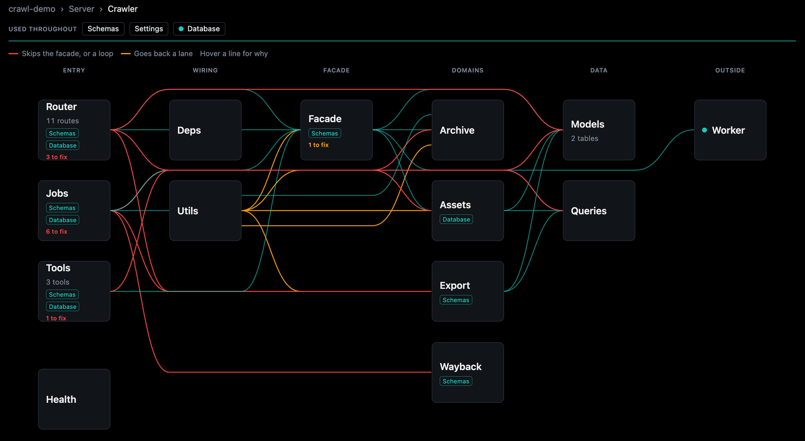
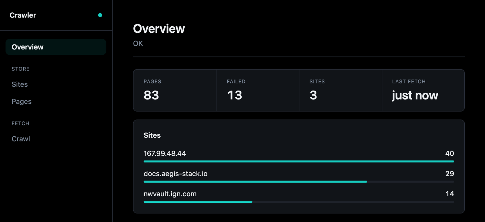

# aegis-stack-crawl4ai

Web crawling for [Aegis Stack](https://github.com/lbedner/aegis-stack) projects. Point it at a
site, or at a site's history in the Wayback Machine, and every page lands in your database as
markdown and the HTML it came from, with its images, stylesheets and downloads kept beside it.
Wraps [crawl4ai](https://github.com/unclecode/crawl4ai) (Apache 2.0). Listed in the
[plugin directory](https://aegis-stack.io/plugins/aegis-stack-crawl4ai).

It is what [NWVault Revival](http://167.99.48.44/) was recovered with: the original Neverwinter
Vault, 2002 to 2014, rebuilt from the archive.

## What it does

- **Crawls live sites.** Seeds, link depth, a page cap, a CSS selector for the part that
  matters, include and exclude globs.
- **Crawls the past.** One domain from the Wayback Machine, between two dates, each page at
  its nearest capture, paced so the archive does not throttle it.
- **Keeps the assets.** The files a page references are fetched once per site and stored by
  content, so the same GIF on three hundred pages is one object.
- **Exports a site** as plain files: pages, assets and a `manifest.json`, as a zip or into the
  object store.

## How it connects



`aegis add crawl4ai` renders an ordinary service into the project, wired into the parts the
stack already has:

- **Database.** Two tables, `crawled_page` and `crawled_asset`, in their own `crawler`
  Postgres schema (unqualified on SQLite), created by an Alembic migration.
- **Worker.** Crawls run on the plugin's own `crawler` queue (arq, TaskIQ or Dramatiq, whichever
  the stack uses), so a webserver restart leaves them running. Without a worker they run in
  the webserver.
- **Jobs.** Each crawl is a framework job: progress streams over
  `/api/v1/jobs/{job_id}/events`, and pages are stored one at a time as they land.
- **Object store.** Assets and stored exports live in the project's `app.core.storage`.
- **Backend.** Routes under `/api/v1/crawler`, and a `crawl` command in the project CLI.
- **Agents.** Three read tools (`crawler_sites`, `crawler_pages`, `crawler_page`) in the app's
  tool registry, so MCP clients and the chat can read the store.
- **Health and frontends.** A `crawler` health check, a card and modal on the dashboard, and
  a Crawler page in the htmx Overseer: Overview, Sites, Pages, and Crawl to start and follow
  a job.



Inside, the routes, jobs and tools go through one facade (`CrawlerService`) to four domains:
archive, assets, export and wayback. The Overseer map above is that structure, read from the
code.

## Install

Inside an Aegis Stack project (aegis-stack 0.16.1 or later):

```bash
uv pip install aegis-stack-crawl4ai
aegis plugins list    # crawl4ai shows as ready
aegis add crawl4ai
```

The plugin needs the `database` component; `aegis add` adds it first when the project lacks
it. The `worker` component is recommended. The fetch is HTTP only, with no browser, so
client-rendered content is out of scope.

## First crawl

```bash
<project> crawl site https://example.com --depth 1 --max-pages 20
<project> crawl stats
```

Or from the API, which answers with a job to follow:

```bash
curl -X POST localhost:8000/api/v1/crawler/crawl-batch \
  -H 'content-type: application/json' \
  -d '{"urls": ["https://example.com"], "options": {"depth": 1, "max_pages": 20}}'
```

## Docs

- [Using it](https://github.com/lbedner/aegis-stack-crawl4ai/blob/main/docs/usage.md): the API,
  the CLI, Python inside the app, agent tools, progress, and a worked bulk fetch.
- [Crawling](https://github.com/lbedner/aegis-stack-crawl4ai/blob/main/docs/crawling.md):
  crawl options, archive snapshots, assets, export.
- [Reference](https://github.com/lbedner/aegis-stack-crawl4ai/blob/main/docs/reference.md):
  settings, the tables, why `crawl4ai>=0.8.6`, the files it adds.

## Develop

```bash
make install     # uv sync
make test        # pytest
make check       # lint + test
make fix         # ruff format + autofix
```

`tests/test_plugin.py` checks the spec contract here. The tests under
`templates/{{ project_slug }}/tests/` ship into the generated project and run
against the real service there, including a layout test that holds the plugin to
the host project's structure.

## License

Apache 2.0, same as upstream crawl4ai.
